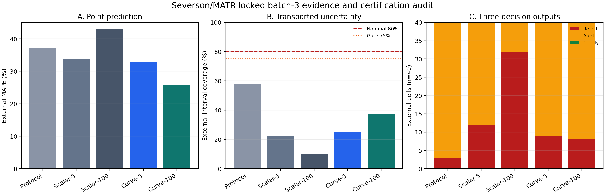

# Severson/MATR 第二外部门实验报告

## 结论

**注册总门：FAIL。** G0、G1、G3 通过；G2 与 G4 失败。不得把本实验表述为“外部安全认证已经成立”。

实验给出一个更有价值的分解结论：结构化电压曲线确实改善了跨批次点预测，但早至第 5 周期的曲线增益没有通过配对置换负控；到第 100 周期，曲线信号变得明确，而从源域校准的 conformal 置信区间仍在外部批次严重失配。**更多或更好的预测信息，不自动等于可运输的认证置信度。**

## 注册门结果

| 门 | 冻结判据 | 结果 |
|---|---|---|
| G0 | 数据、拆分与时间顺序完整 | PASS |
| G1 | 5-cycle 曲线优于 100-cycle 标量遥测至少 10% | PASS |
| G2 | 5-cycle 曲线优于置换负控至少 5% | FAIL |
| G3 | 侧误差与 balanced decisiveness 达标 | PASS |
| G4 | 外部区间覆盖率至少 75% | FAIL |

## 锁定外部批次指标

| 证据菜单 | MAPE | RMSE（周期） | 80% 区间覆盖 | balanced decisiveness | unsafe→Certify | safe→Reject |
|---|---:|---:|---:|---:|---:|---:|
| protocol | 37.0% | 504.3 | 57.5% | 25.0% | 0.0% | 0.0% |
| scalar5 | 33.9% | 456.6 | 22.5% | 29.8% | 0.0% | 26.3% |
| scalar100 | 42.9% | 520.8 | 10.0% | 84.2% | 0.0% | 68.4% |
| curve5 | 32.9% | 448.7 | 25.0% | 24.6% | 0.0% | 15.8% |
| curve100 | 25.8% | 367.9 | 37.5% | 36.0% | 0.0% | 5.3% |

外部集含 40 个独立电芯：6 个 unsafe（≤800）、15 个缓冲带、19 个 safe（≥1000）。

## 逐门解释

### 1. “少量新结构证据”在点预测上击败了“更多旧标量数据”

`curve5` 的外部 MAPE 为 32.9%，`scalar100` 为 42.9%，相对降低 23.4%，超过注册的 10% 门槛。`curve100` 进一步降到 25.8%，相对 `scalar100` 降低 39.8%。

这支持一个受限陈述：在该数据集和该冻结模型下，电压-容量曲线变化包含标量容量、温度、内阻与充电时间汇总没有保留的跨批次寿命信息。

### 2. 5-cycle “新证据”没有击穿负控

`curve5` 的 200 次曲线列置换负控中位 MAPE 为 33.6%；真实配对只改善 2.1%，未达到注册的 5% 门，单侧随机化 p=0.3731。因此不能把 G1 的全部改善归因于第 5 周期曲线与电芯寿命之间的稳定配对关系。

作为**注册后诊断而非改门**，`curve100` 相对其置换中位数改善 39.8%，单侧随机化 p=0.0050。这表明“正确证据何时成熟”本身存在时间门：第 5 周期尚弱，第 100 周期明确。

### 3. 置信度运输失败

所有菜单的外部 80% 区间覆盖率都低于注册目标；最好的是 `protocol` 的 57.5%，`curve100` 仅 37.5%。源域 fit/calibration 中 safe 电芯分别只有 4/6 个，而外部批次有 19 个，并伴随约一年的日历老化差异；校准残差不可交换，split-conformal 的源域有限样本保证不能直接运输到 batch 3。

### 4. G3 的技术通过不能误读成双向认证成功

`curve100` 按冻结的“balanced decisiveness + 双侧错误上限”形式满足 G3，但五个正式菜单在外部集都输出 **0 个 `Certify`**。`curve100` 的 8 个决定性输出全部是 `Reject`，其中 1 个落在真实 safe 侧。因此 G3 是一个偏向拒绝侧的技术通过；实验没有展示可用的正向安全认证能力。这个诊断不追溯修改已冻结的 G3，而是收紧论文中的结论语言。

## 科学含义

1. 证据类型可以形成强关联，但必须靠“真实配对优于同边际置换”来审计；仅看模型误差下降不够。
2. 证据价值具有成熟时间：本实验没有确认第 5 周期曲线的稳定价值，却确认了第 100 周期曲线的强信号。
3. 统计置信度是独立的一道门。即使 `curve100` 的 MAPE 显著改善，外域区间覆盖仍崩溃，点预测前沿与认证前沿不能混同。
4. 本结果支持理论主线的“必要性”部分，但不提供“已经可部署认证”的正面实证。

## 可复现性与边界

- 数据拆分、特征菜单、阈值、模型、种子、置换次数与门槛见 `docs/FROZEN_PROTOCOL.md`。
- `data/processed/registered_features.csv` 是由官方原始 MATLAB v7.3 文件按固定脚本生成的轻量派生表。
- 原始约 8.2 GB 数据不随代码包再分发；`data/RAW_MANIFEST.sha256` 记录来源、字节数与 SHA-256。
- 周期是同一电芯的重复观测；所有误差与拆分均以电芯为单位。
- 充电策略不是在本实验中识别的因果处理；本报告不声称充电策略的因果效应。
